# Executive & Technical Brief — Scott Hardie

 

**[Profile README](README.md)** · **[Architecture Playbook](architecture-playbook/README.md)** · **[LinkedIn](https://www.linkedin.com/in/scottrmhardie/)** · **[scottrmhardie@gmail.com](mailto:scottrmhardie@gmail.com?subject=Role%20or%20systems%20conversation)**

---

## 1. Executive Summary

**Scott Hardie** is a **Solutions Architect at McGraw Hill** (President's Award for Sales Excellence recipient) and the creator of **Hardonia**, an open-source portfolio of deterministic control planes, kernel isolation layers, inference FinOps routers, and formal verification tooling built from Toronto, Canada.

He operates at the intersection of two disciplines that rarely overlap:

1. **Hands-on systems and AI platform engineering:** designing and implementing production software in Rust, Go, TypeScript, Python, PostgreSQL, eBPF, Quint, and Lean 4.
2. **Enterprise technical strategy and commercial delivery:** leading architecture, identity integration (`OAuth 2.0`, `OIDC`, `SCIM`, `LTI 1.3`, `OneRoster 1.2`), security review (`SOC 2`, `FERPA`), and executive stakeholder alignment for large institutional deployments.

---

## 2. Core Technical Thesis

Enterprise AI projects rarely fail because the underlying foundation model is weak. They stall in security review, audit, or production operations because teams wrap probabilistic models in thin application code that cannot guarantee:

- **Tenant isolation:** application-level `WHERE tenant_id = ?` filters can be omitted by generated queries or bypassed by tool bugs.
- **Least-privilege tool execution:** passing raw API credentials or broad tool schemas to a model allows prompt injection to trigger unauthorized side effects.
- **Predictable inference economics:** recursive agent retries and multi-step tool loops compound latency and token spend before billing alerts fire.
- **Deterministic state & replayability:** concurrent workers and network retries mutate state out of causal order without cryptographic audit trails.

Hardonia addresses these failure modes as a **five-stage systems loop**:

| Stage | Architectural Boundary | Enforced Invariant | Primary Repositories |
| :--- | :--- | :--- | :--- |
| **01 · Observe** | Inference Telemetry & FinOps | Sub-millisecond token accounting, hard tenant quota circuit breakers, and policy-checked fallback routing. | [TokenGoblin](https://github.com/Hardonian/TokenGoblin) · [TokPulse (`v3.0.0`)](https://github.com/Hardonian/TokPulse) |
| **02 · Control** | Out-of-Band Policy Gateway | Models emit unprivileged intent; an external MCP gateway evaluates policy and mints single-use approval tokens bound to SHA-256 argument hashes. | [ReadyLayer](https://github.com/Hardonian/ReadyLayer) · [ControlPlane (`v1.0.0`)](https://github.com/Hardonian/ControlPlane) · [FORGE (`v1.0.0`)](https://github.com/Hardonian/FORGE) |
| **03 · Execute** | Database & Kernel Isolation | Tenant boundaries enforced in PostgreSQL via `FORCE ROW LEVEL SECURITY`; untrusted bytecode isolated in deterministic eBPF ZK-VMs. | [Settler (`v1.8.0`)](https://github.com/Hardonian/Settler) · [zerokernel (`v1.0.0`)](https://github.com/Hardonian/zerokernel) |
| **04 · Prove** | Formal Specification & Compilers | Distributed DAG transitions checked against Quint state models; extremal claims verified in Lean 4 (`Zero Axioms`); XLA compiler bugs delta-minimized. | [veridag](https://github.com/Hardonian/veridag) · [GRAPH-Lab](https://github.com/Hardonian/GRAPH-Lab) · [SAT-Frontier (`v0.2.9`)](https://github.com/Hardonian/SAT-Frontier) · [XLAxiom](https://github.com/Hardonian/XLAxiom) |
| **05 · Reconcile** | Cryptographic Audit Ledger | Two-way financial/operational reconciliation and SHA-256 trace envelopes that support deterministic replay. | [Settler (`v1.8.0`)](https://github.com/Hardonian/Settler) |

---

## 3. Portfolio & Maturity Matrix

Every public repository separates released (`stable`), functional (`beta`), and exploratory (`research`) work and links directly to its verification surface:

| Repository | Language / Stack | Maturity & Tag | Problem Solved | Public Verification Surface |
| :--- | :--- | :--- | :--- | :--- |
| **[Settler](https://github.com/Hardonian/Settler)** | TypeScript · PostgreSQL RLS | `stable` · [`v1.8.0`](https://github.com/Hardonian/Settler/releases/tag/v1.8.0) | Multi-tenant financial and operational reconciliation with strict tenant isolation. | [Architecture](https://github.com/Hardonian/Settler/blob/main/docs/ARCHITECTURE.md) · [Benchmark Suite](https://github.com/Hardonian/Settler/blob/main/benchmarks/reconciliationBenchmark.ts) · [Security CI](https://github.com/Hardonian/Settler/actions/workflows/security.yml) |
| **[ControlPlane](https://github.com/Hardonian/ControlPlane)** | Rust · TypeScript | `stable` · `v1.0.0` | Deterministic orchestration, bounded memory buffers, and telemetry backpressure for autonomous workflows. | [Repository & Release Tags](https://github.com/Hardonian/ControlPlane) |
| **[FORGE](https://github.com/Hardonian/FORGE)** | TypeScript · Python | `stable` · `v1.0.0` | End-to-end enterprise AI system builder and governed agent lifecycle runner. | [Repository & Release Tags](https://github.com/Hardonian/FORGE) |
| **[zerokernel](https://github.com/Hardonian/zerokernel)** | Rust · eBPF · ZK | `stable` · `v1.0.0` | Zero-knowledge eBPF kernel sandboxing with instruction metering and cryptographic execution receipts. | [Repository & Release Tags](https://github.com/Hardonian/zerokernel) |
| **[TokPulse](https://github.com/Hardonian/TokPulse)** | Go · OpenTelemetry | `stable` · `v3.0.0` | Real-time token stream observability, latency tracking, and spend alerting. | [Repository & Release Tags](https://github.com/Hardonian/TokPulse) |
| **[TokenGoblin](https://github.com/Hardonian/TokenGoblin)** | Go | `beta` | High-throughput LLM usage ingestion, cost attribution, and deterministic fallback routing. | [Architecture Spec](https://github.com/Hardonian/TokenGoblin/blob/main/docs/ARCHITECTURE_AND_SPEC.md) · [Ingestion Benchmarks](https://github.com/Hardonian/TokenGoblin/blob/main/internal/ingestion/benchmark_test.go) |
| **[ReadyLayer](https://github.com/Hardonian/ReadyLayer)** | TypeScript | `beta` | Policy-gated AI software delivery, capability contracts, and auditable evidence export. | [Runner Architecture](https://github.com/Hardonian/ReadyLayer/blob/main/docs/runner/ARCHITECTURE.md) · [Evidence Contract](https://github.com/Hardonian/ReadyLayer/blob/main/docs/EVIDENCE.md) |
| **[SAT-Frontier](https://github.com/Hardonian/SAT-Frontier)** | Python · SAT | `beta` · `v0.2.9` | Automated SAT encoding, solver benchmarking, and counterexample search. | [Repository & Release Tags](https://github.com/Hardonian/SAT-Frontier) |
| **[veridag](https://github.com/Hardonian/veridag)** | Rust · Quint | `research` | Capability-checked causal DAG execution validated against formal Quint specifications. | [Protocol Architecture](https://github.com/Hardonian/veridag/blob/main/docs/architecture.md) · [Quint Formal Models](https://github.com/Hardonian/veridag/blob/main/formal/README.md) |
| **[XLAxiom](https://github.com/Hardonian/XLAxiom)** | Python · JAX/OpenXLA | `research` | Automated HLO graph delta-minimization for isolating numerical discrepancies in ML compilers. | [Repository & Reproducers](https://github.com/Hardonian/XLAxiom) |
| **[GRAPH-Lab](https://github.com/Hardonian/GRAPH-Lab)** | Lean 4 · Python | `research` | Combinatorial counterexample search paired with Lean 4 kernel-checked proof witnesses (`Zero Axioms`). | [Repository & Proofs](https://github.com/Hardonian/GRAPH-Lab) |

---

## 4. Enterprise Delivery & Commercial Track Record

- **Current Role:** Solutions Architect at **McGraw Hill** (Toronto, Canada).
- **Commercial Recognition:** **President's Award for Sales Excellence**, recognizing technical leadership on complex, high-value institutional deals.
- **Integration & Security Standards:** Production architecture experience across `OAuth 2.0`, `Keycloak OIDC`, `SCIM`, `LTI 1.3 Advantage`, `OneRoster 1.2`, `Model Context Protocol (MCP)`, `OpenTelemetry`, `SOC 2`, and `FERPA`.
- **Frontier AI Evaluation:** Part-time contributor to confidential frontier-AI evaluation and systems initiatives (all client, model, and dataset specifics remain under strict NDA).
- **Owned Hardware Testbed:** Dedicated local compute lab (`AMD EPYC 7452` 32C/64T server, `AMD Ryzen AI 9 HX370` NPU workstation, and `NVIDIA V100 / P40 / RTX 3060` accelerators) used for quantized routing, compiler bisection, and failure-injection testing.

---

## 5. Architecture Monograph Series

1. **[01 // Building Safe Multi-Tenant AI Agents with Postgres RLS](OPENAI_CAMPAIGN/content/01_safe_multi_tenant_ai_agents_postgres_rls.md)** — Enforcing session-scoped JWT tenant isolation in the PostgreSQL kernel via `FORCE ROW LEVEL SECURITY`.
2. **[02 // Enterprise Tool Calling: Why Authorization Belongs Outside the Model](OPENAI_CAMPAIGN/content/02_enterprise_tool_calling_authorization_outside_model.md)** — Decoupling model intent from privileged execution with MCP policy gateways and single-use approval tokens.
3. **[03 // From Prototype to Production: Architecture for Enterprise AI Agents](OPENAI_CAMPAIGN/content/03_from_prototype_to_production_enterprise_agents.md)** — Dynamic model fallback, hard token spend caps, CI evaluation suites, and secret-scrubbed OpenTelemetry tracing.
4. **[04 // Zero-Knowledge eBPF Sandboxing & Causal DAG Execution](OPENAI_CAMPAIGN/content/04_zero_knowledge_ebpf_sandboxing_and_causal_dags.md)** — Quint state-machine preconditions, `zerokernel` eBPF ZK-VMs, and replayable `Settler` SHA-256 evidence envelopes.

---

## 6. Contact & Engagement Paths

| Audience | Focus Areas | Direct Contact |
| :--- | :--- | :--- |
| **Hiring Leaders & Executive Recruiters** | Senior / Staff / Principal Applied AI Engineer · AI Platform Engineer · Distributed Systems Engineer · Principal Solutions Architect | [LinkedIn](https://www.linkedin.com/in/scottrmhardie/) · [Email](mailto:scottrmhardie@gmail.com?subject=Engineering%20or%20Architecture%20Role) |
| **Founders, Investors & Technical Advisory** | AI control-plane architecture reviews, multi-tenant database isolation audits, LLM FinOps governance, and technical due diligence | [LinkedIn](https://www.linkedin.com/in/scottrmhardie/) · [Email](mailto:scottrmhardie@gmail.com?subject=Architecture%20Advisory%20or%20Due%20Diligence) |
