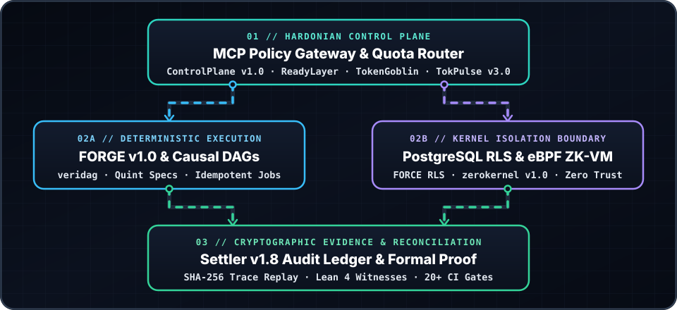
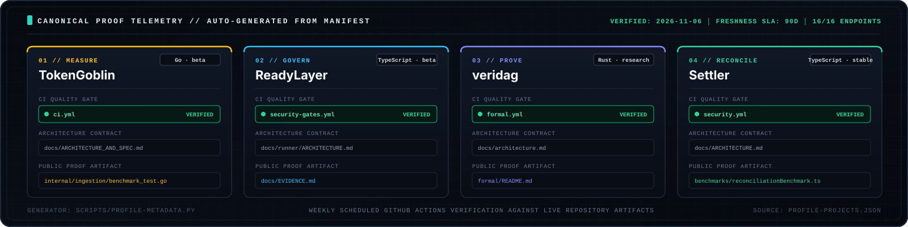

# Architecture Playbook

Public architecture notes for the Hardonia Sovereign AI Operations platform.

This page explains the migration and product-operations patterns behind the platform. It is reference documentation, not a promise that every route or deployment topology is publicly reachable or production-ready.

---

## Platform position

`Observe → Control → Operate → Prove → Monetize`

Migration Factory and the AI Lab Command Center sit primarily in the Control and Operate layers. The shared evidence envelope supplies the Prove layer; checkout, audit, compute, and implementation surfaces supply the Monetize layer.

| Stage | Bounded Context | Enforced Invariant | Verification Artifact |
| --- | --- | --- | --- |
| **01 // Observe & Scope** | `Settler` · PostgreSQL Kernel | Session-scoped `app.current_tenant_id` enforced via `FORCE ROW LEVEL SECURITY`. | Negative cross-tenant security tests |
| **02 // Quota & Routing** | `TokenGoblin` · `TokPulse` | Hard token spend ceiling & latency budget checked prior to model dispatch. | Sub-millisecond ingestion benchmarks |
| **03 // Policy Gateway** | `ReadyLayer` · `FORGE` | Unprivileged model emits candidate intent; MCP gateway mints 1-use capability token. | Policy contracts & CI security gates |
| **04 // Causal Execution** | `veridag` · `zerokernel` | Preconditions verified against Quint state models; isolated in ZK-proved eBPF sandboxes. | Cross-language conformance vectors |
| **05 // Proof & Reconcile** | `Settler` · Audit Ledger | SHA-256 cryptographic trace leaf appended; 2-way ledger reconciliation verified. | Checked-in reconciliation snapshots |

---

## Capability map

| Capability | Public contract | Evidence boundary |
| --- | --- | --- |
| Fulfillment orchestration | Authenticated operator workflow | Entitlement and delivery events are recorded internally |
| Download delivery | Signed, time-bound customer URL | Customer-specific tokens are never documented or exposed here |
| Health | `GET /health` on the relevant local service | A health response is not proof of payment or revenue |
| Operator summary | Authenticated operator API | Raw customer, payment, and local-path data stays private |

Internal source paths and deployment filesystem locations are intentionally omitted from this public page. Use the repository's local runbooks and environment configuration for operator setup.

---

## Verified Production Releases

The following flagship platforms have completed automated verification dry-runs, CI gating, and tag cuts:

| Subsystem | Milestone Tag | Focus Area | Verification Surface |
| :--- | :--- | :--- | :--- |
| **[Settler](https://github.com/Hardonian/Settler)** | `v1.8.0` | Multi-Tenant Reconciliation Engine | 20+ CI gates, Next.js 16.4.1 bump, 315 pages built, 8 npm packages validated |
| **[FORGE](https://github.com/Hardonian/FORGE)** | `v1.0.0` | Enterprise AI Systems Builder | Official GA release, full agent lifecycle verification |
| **[zerokernel](https://github.com/Hardonian/zerokernel)** | `v1.0.0` | ZK-Proved eBPF Kernel Sandboxing | Official GA release, guest/host zero-knowledge verifier suite |
| **[ControlPlane](https://github.com/Hardonian/ControlPlane)** | `v1.0.0` | Hardonian Control Plane Runtime | Official LTS release, determinism and backpressure guarantees |
| **[SAT-Frontier](https://github.com/Hardonian/SAT-Frontier)** | `v0.2.9` | Automated SAT Solving & Reasoning | Formal verification and automated theorem prover benchmarks |
| **[TokPulse](https://github.com/Hardonian/TokPulse)** | `v3.0.0` | Token & Inference Observability | Sub-millisecond stream ingestion, Prometheus & Grafana alerting |

---

## Architecture concerns

- Define data ownership before extracting a bounded capability.
- Put routing and cutover behind an explicit, reversible control point.
- Shadow-validate behavior before changing customer traffic.
- Emit evidence for decisions, releases, fulfillment, and rollback.
- Keep tenant, identity, entitlement, payment, and webhook boundaries explicit.
- Separate technical readiness from provider-backed payment and realized revenue evidence.

## Architecture Monograph Series

- [01 // Building Safe Multi-Tenant AI Agents with Postgres RLS](../OPENAI_CAMPAIGN/content/01_safe_multi_tenant_ai_agents_postgres_rls.md)
- [02 // Enterprise Tool Calling: Why Authorization Belongs Outside the Model](../OPENAI_CAMPAIGN/content/02_enterprise_tool_calling_authorization_outside_model.md)
- [03 // From Prototype to Production: Architecture for Enterprise AI Agents](../OPENAI_CAMPAIGN/content/03_from_prototype_to_production_enterprise_agents.md)
- [04 // Zero-Knowledge eBPF Sandboxing & Causal DAG Execution](../OPENAI_CAMPAIGN/content/04_zero_knowledge_ebpf_sandboxing_and_causal_dags.md)

## Related public surfaces

- [Hardonian Profile](https://github.com/Hardonian/Hardonian)
- [Executive & Technical Brief](../EXECUTIVE_BRIEF.md)
- [ControlPlane (AI Operator & Control Plane Engine)](https://github.com/Hardonian/ControlPlane)
- [ReadyLayer (Governance & Software Delivery)](https://github.com/Hardonian/ReadyLayer)
- [Storefront & Evidence Console](https://github.com/Hardonian/storefront)
- [AI Automated Systems Storefront](https://www.aiautomatedsystems.ca)

## Usage rules

- Keep payer-facing claims factual and sourced from the canonical catalog and current evidence artifacts.
- Do not publish local paths, credentials, raw logs, customer identifiers, webhook payloads, or private checkout details.
- Do not call a catalog row, local purchase row, or generated artifact realized revenue without provider correlation.
- Keep buyer-facing pages focused on outcomes; keep operator routes and internal implementation notes in private runbooks.

## Changelog

- 2026-11-06: Simplified visual schematics to 1:1 native scale and updated verified production release milestones.
- 2026-08-02: Reframed as a public architecture reference and removed internal filesystem-path and route-fulfillment claims.
