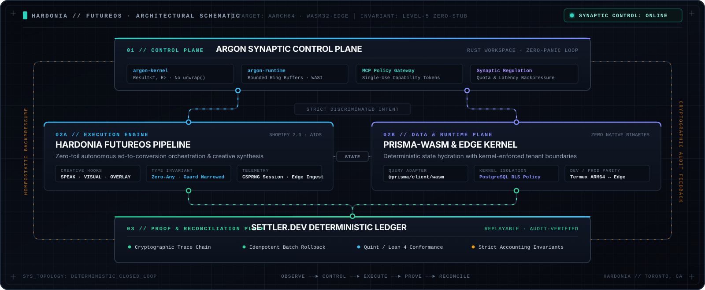
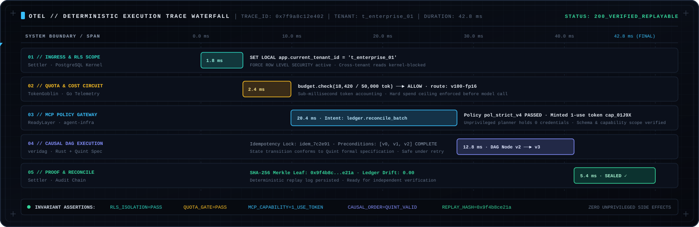
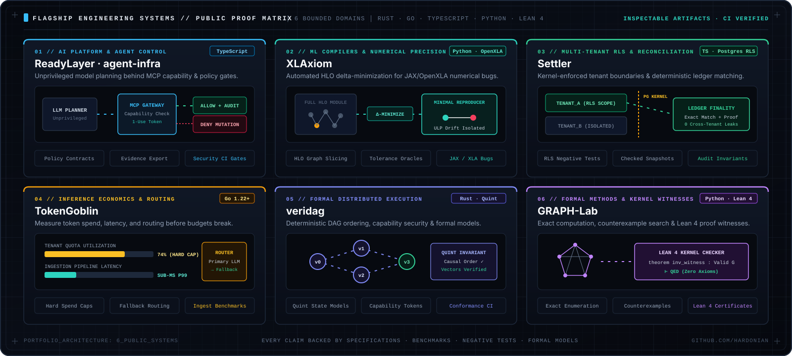

# Architecture Playbook

Public architecture notes for the Hardonia Sovereign AI Operations platform.

This page explains the migration and product-operations patterns behind the platform. It is reference documentation, not a promise that every route or deployment topology is publicly reachable or production-ready.

---

## Platform position

`Observe → Control → Operate → Prove → Monetize`

Migration Factory and the AI Lab Command Center sit primarily in the Control and Operate layers. The shared evidence envelope supplies the Prove layer; checkout, audit, compute, and implementation surfaces supply the Monetize layer.

---

## End-to-end deterministic execution trace

Every privileged operation traverses five explicit system boundaries before mutating state or committing to the ledger:

| Stage | Bounded Context | Enforced Invariant | Verification Artifact |
| --- | --- | --- | --- |
| **01 // Observe & Scope** | `Settler` · PostgreSQL Kernel | Session-scoped `app.current_tenant_id` enforced via `FORCE ROW LEVEL SECURITY`. | Negative cross-tenant security tests |
| **02 // Quota & Routing** | `TokenGoblin` · Go Telemetry | Hard token spend ceiling & latency budget checked prior to model dispatch. | Sub-millisecond ingestion benchmarks |
| **03 // Policy Gateway** | `ReadyLayer` · `agent-infra` | Unprivileged model emits candidate intent; MCP gateway mints 1-use capability token. | Policy contracts & CI security gates |
| **04 // Causal Execution** | `veridag` · Rust + Quint | Preconditions and topological ordering verified against Quint formal state models. | Cross-language conformance vectors |
| **05 // Proof & Reconcile** | `Settler` · Audit Ledger | SHA-256 cryptographic trace leaf appended; 2-way ledger reconciliation verified. | Checked-in reconciliation snapshots |

---

## Capability map

| Capability | Public contract | Evidence boundary |
| --- | --- | --- |
| Fulfillment orchestration | Authenticated operator workflow | Entitlement and delivery events are recorded internally |
| Download delivery | Signed, time-bound customer URL | Customer-specific tokens are never documented or exposed here |
| Health | `GET /health` on the relevant local service | A health response is not proof of payment or revenue |
| Operator summary | Authenticated operator API | Raw customer, payment, and local-path data stays private |

Internal source paths and deployment filesystem locations are intentionally omitted from this public page. Use the repository's local runbooks and environment configuration for operator setup.

---

## Flagship bounded domains

## Architecture concerns

- Define data ownership before extracting a bounded capability.
- Put routing and cutover behind an explicit, reversible control point.
- Shadow-validate behavior before changing customer traffic.
- Emit evidence for decisions, releases, fulfillment, and rollback.
- Keep tenant, identity, entitlement, payment, and webhook boundaries explicit.
- Separate technical readiness from provider-backed payment and realized revenue evidence.

## Related public surfaces

- [Hardonian Profile](https://github.com/Hardonian/Hardonian)
- [ControlPlane (AI Operator & Control Plane Engine)](https://github.com/Hardonian/ControlPlane)
- [ReadyLayer (Governance & Software Delivery)](https://github.com/Hardonian/ReadyLayer)
- [Storefront & Evidence Console](https://github.com/Hardonian/storefront)
- [AI Automated Systems Storefront](https://www.aiautomatedsystems.ca)

## Usage rules

- Keep payer-facing claims factual and sourced from the canonical catalog and current evidence artifacts.
- Do not publish local paths, credentials, raw logs, customer identifiers, webhook payloads, or private checkout details.
- Do not call a catalog row, local purchase row, or generated artifact realized revenue without provider correlation.
- Keep buyer-facing pages focused on outcomes; keep operator routes and internal implementation notes in private runbooks.

## Changelog

- 2026-11-03: Added visual control-plane schematics, deterministic OpenTelemetry trace waterfall, and bounded-context invariant table.
- 2026-08-02: Reframed as a public architecture reference and removed internal filesystem-path and route-fulfillment claims.
